# Hyper-V Lab: Build a Windows Server 2019 Active Directory Domain

> Step-by-step guide with screenshots: Hyper-V, Windows Server 2019, Active Directory Domain Services, OUs and a test user.

## Contents

- [Part 1: Enable Hyper-V on the host PC](#part-1-enable-hyper-v-on-the-host-pc)
- [Part 2: Create the virtual switch](#part-2-create-the-virtual-switch)
- [Part 3: Create the Domain Controller virtual machine](#part-3-create-the-domain-controller-virtual-machine)
- [Part 4: Install Windows Server 2019](#part-4-install-windows-server-2019)
- [Part 5: Rename the server and set a static IP](#part-5-rename-the-server-and-set-a-static-ip)
- [Part 6: Install Active Directory Domain Services](#part-6-install-active-directory-domain-services)
- [Part 7: Create OUs and a test user](#part-7-create-ous-and-a-test-user)
- [Part 8: Verify the Domain Controller](#part-8-verify-the-domain-controller)

## About this guide

This guide shows how to build a small **Active Directory lab on one Windows PC using Hyper-V**. You create a virtual switch, a Windows Server 2019 virtual machine, promote it to a Domain Controller for the domain **lab.local**, and add Organizational Units (OUs) and a test user. Screenshots are included for the main steps.

**What you will build**

- An isolated Hyper-V network (Internal virtual switch)
- A Windows Server 2019 VM named LAB-DC01 with a static IP
- An Active Directory domain: lab.local (NetBIOS name LAB)
- OUs for Head Office (Accounts Dept, IT Dept) and a test user

**Requirements**

- Windows 10/11 Pro, Enterprise or Education as the host (Hyper-V is not available on Home)
- Virtualization (Intel VT-x or AMD-V) enabled in BIOS
- At least 8 GB RAM (16 GB recommended) and 100 GB free disk space, SSD preferred
- Windows Server 2019 Evaluation ISO from the Microsoft Evaluation Center (free, 180 days)

**Values used in this guide**

- Virtual switch: **LabSwitch** (Internal)
- Server VM: **LAB-DC01**, Generation 2
- Domain: **lab.local**, NetBIOS name **LAB**
- Server IP address and DNS: **192.168.100.10**
> **Note:** This setup is for learning and testing only. The passwords and settings shown are lab examples; choose strong passwords and settings that match your needs in a real environment.

---
## Part 1: Enable Hyper-V on the host PC

1. Open the search box and type **Turn Windows features on or off**.

   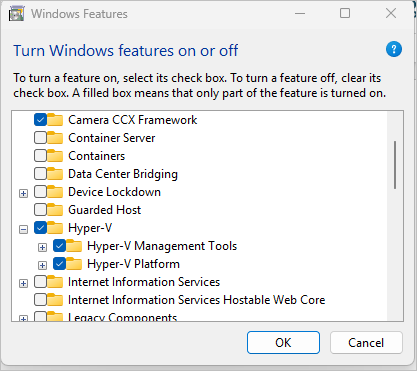

2. Make sure **Hyper-V** is ticked, including both **Hyper-V Management Tools** and **Hyper-V Platform**. Windows installs the required files automatically.

3. Click **OK** and **restart** the PC when asked.

4. Open the Start menu, type **hyper** and open **Hyper-V Manager**.

   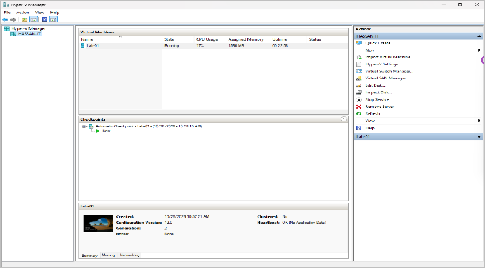

---
## Part 2: Create the virtual switch

1. In Hyper-V Manager, on the right side click **Virtual Switch Manager**.

   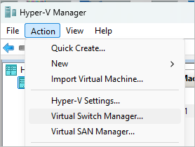

2. Select **New virtual network switch**, choose **Internal**, then click **Create Virtual Switch**.

   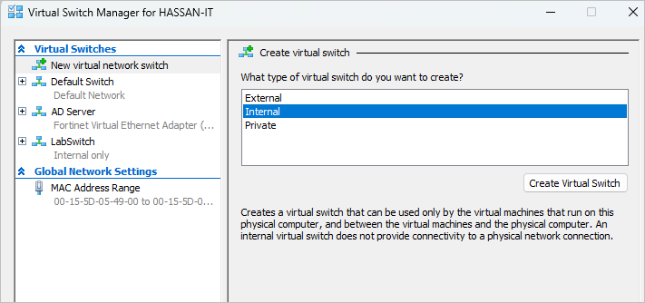

3. Name it **LabSwitch** (any name works) and click **OK**.

> **Note:** An Internal switch keeps the lab separate from your real network, so the lab Domain Controller cannot interfere with your DHCP or DNS.

---
## Part 3: Create the Domain Controller virtual machine

1. Click **Action > New > Virtual Machine**, then **Next**.

   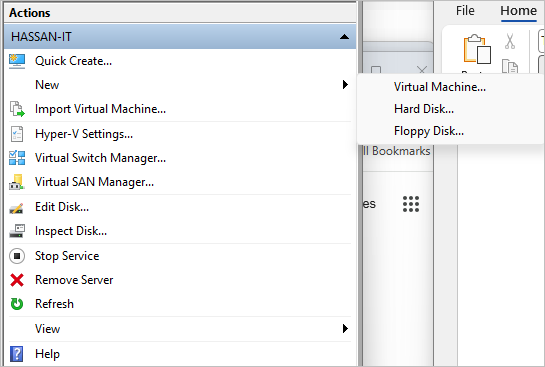

2. Name: **LAB-DC01** (any name works).

   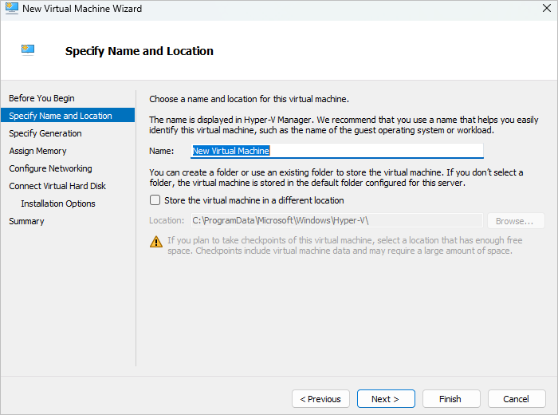

3. Select the location according to your free disk space.

   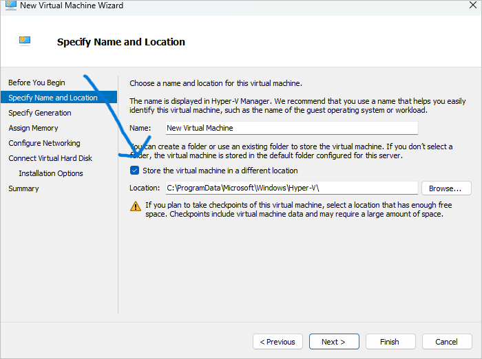

4. Select **Generation 2**. Generation 2 uses UEFI firmware; Generation 1 uses legacy BIOS.

   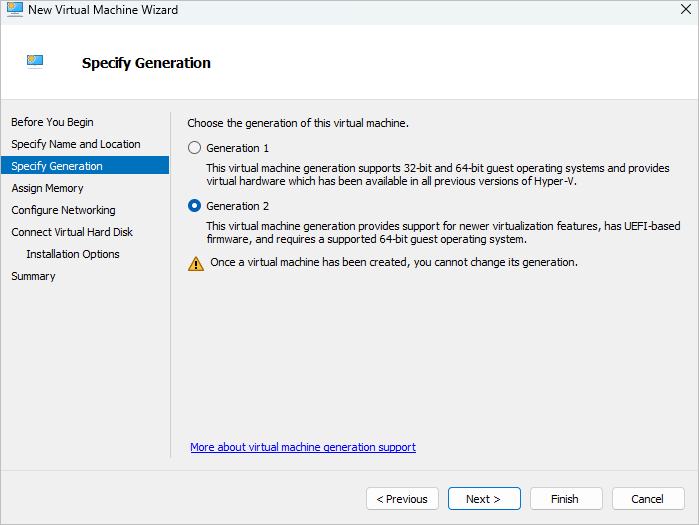

5. Startup memory: enter the amount you want. For a Domain Controller use at least **2048 MB** (4096 MB is better if the host has 16 GB RAM).

   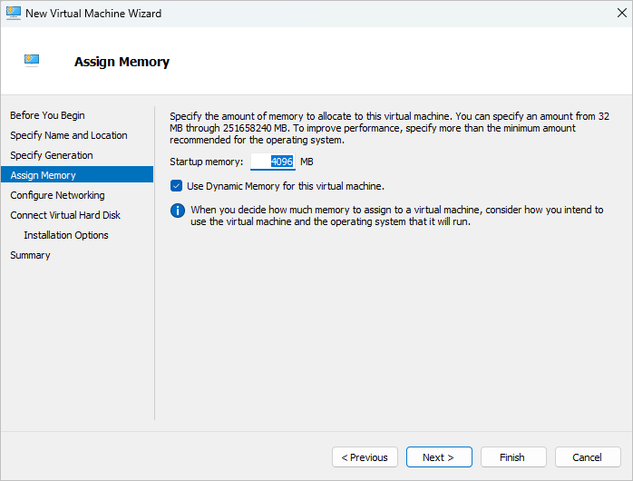

6. Untick **Use Dynamic Memory**. A fixed amount of memory works better for a Domain Controller.

   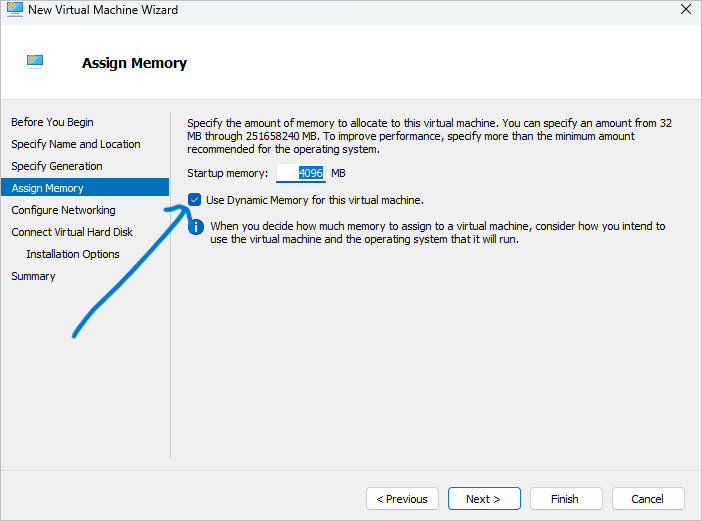

7. Network: select **LabSwitch**, the switch created in Part 2.

   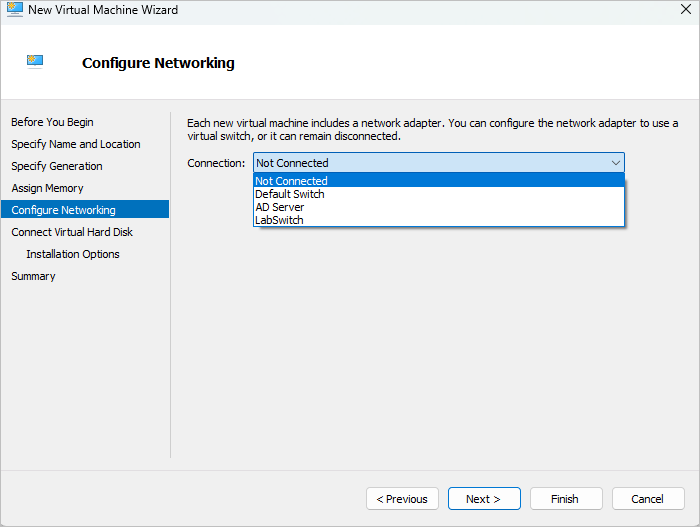

8. Virtual hard disk: size **60 GB**. The disk grows only as much as it is used.

   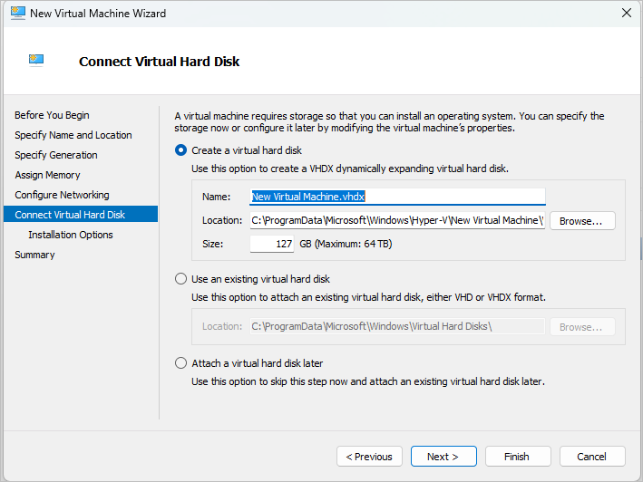

9. Installation options: choose **Install an operating system from a bootable image file**, browse to the Windows Server 2019 ISO and click **Finish**.

   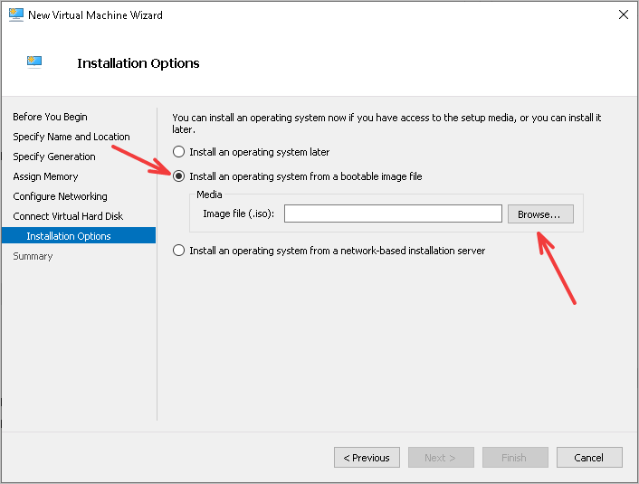

10. Before the first start, right-click the VM > **Settings > Processor** and set **2** virtual processors.

   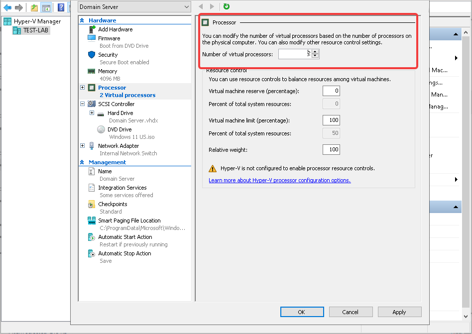

11. Under **Security**, make sure **Enable Secure Boot** is ticked (template: Microsoft Windows).

   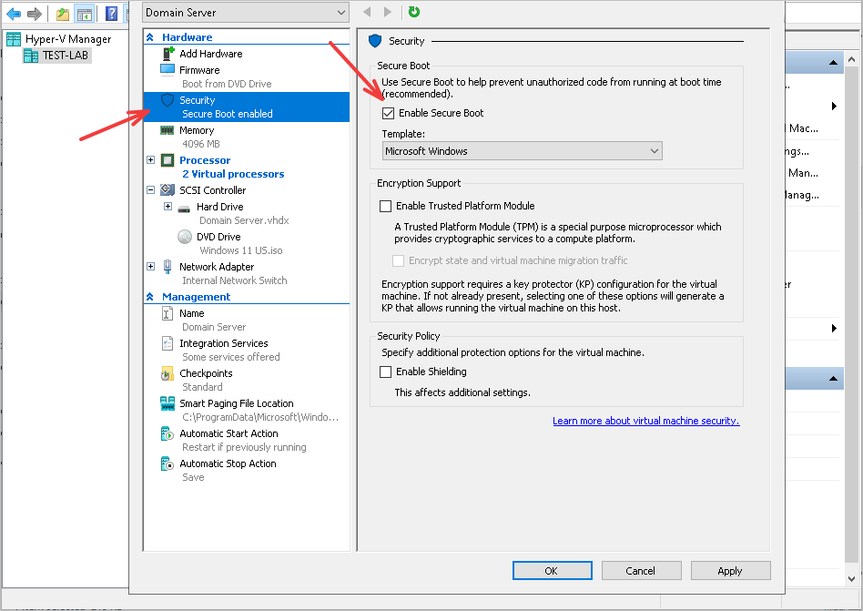

---
## Part 4: Install Windows Server 2019

1. In Hyper-V Manager right-click **LAB-DC01 > Connect**, then click **Start**.

2. When "Press any key to boot from CD or DVD" appears, press any key immediately.

3. Select language and keyboard, then click **Install now**.

   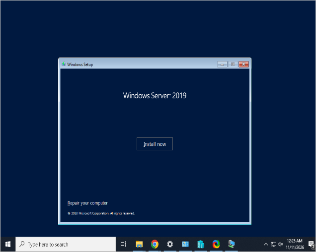

   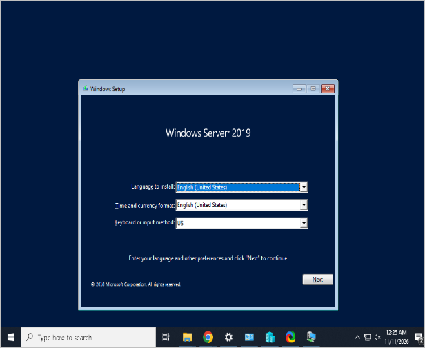

4. Choose **I don't have a product key** (evaluation), then select **Windows Server 2019 Standard Evaluation (Desktop Experience)**.

   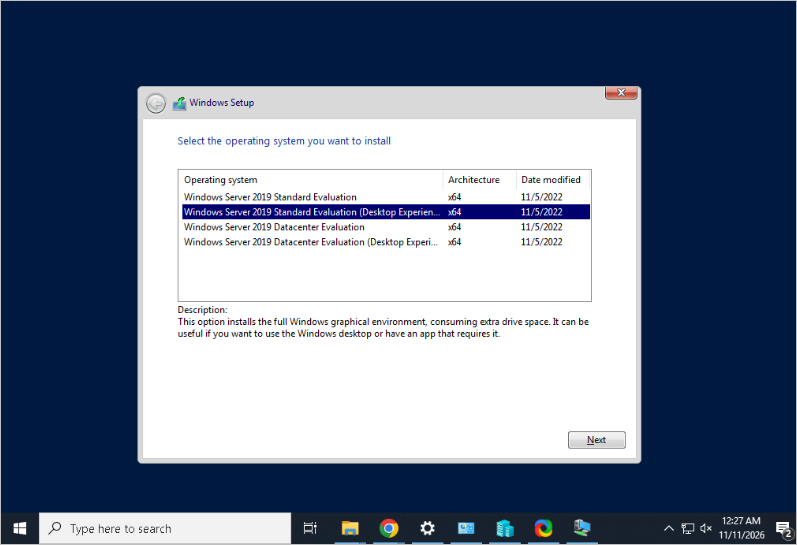

> **Note:** Choose the edition that has **Desktop Experience** in its name. The other edition is Server Core, which has only a command window and cannot be converted to the graphical version later.

5. Accept the license terms, choose **Custom: Install Windows only**, select the **Unallocated Space** and click **Next**.

6. Set the **Administrator** password (use capital letters, small letters and numbers) and click **Finish**.

   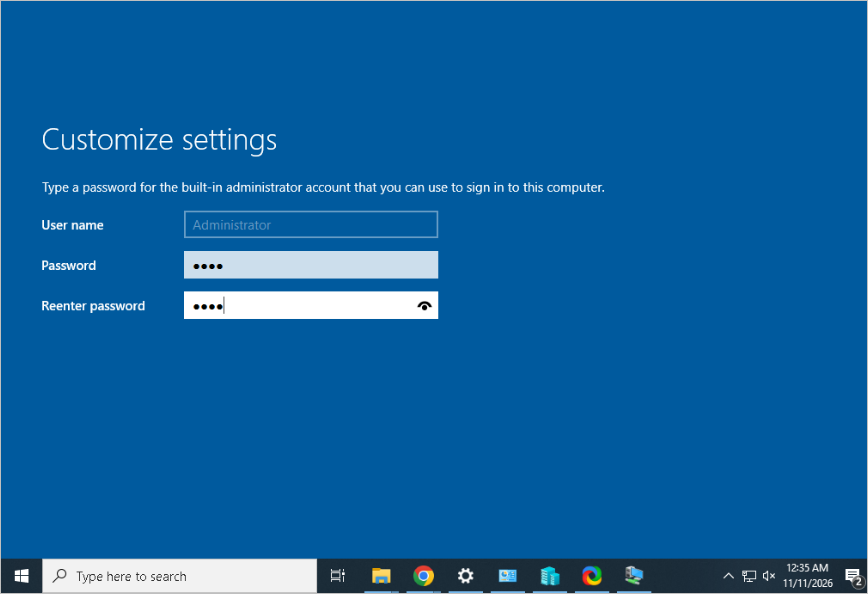

7. Sign in. In the VM window use the menu **Action > Ctrl+Alt+Delete**, because the host keyboard shortcut does not reach the VM.

8. Check the edition: **Settings > System > About**. It should show Windows Server 2019 Standard Evaluation.

   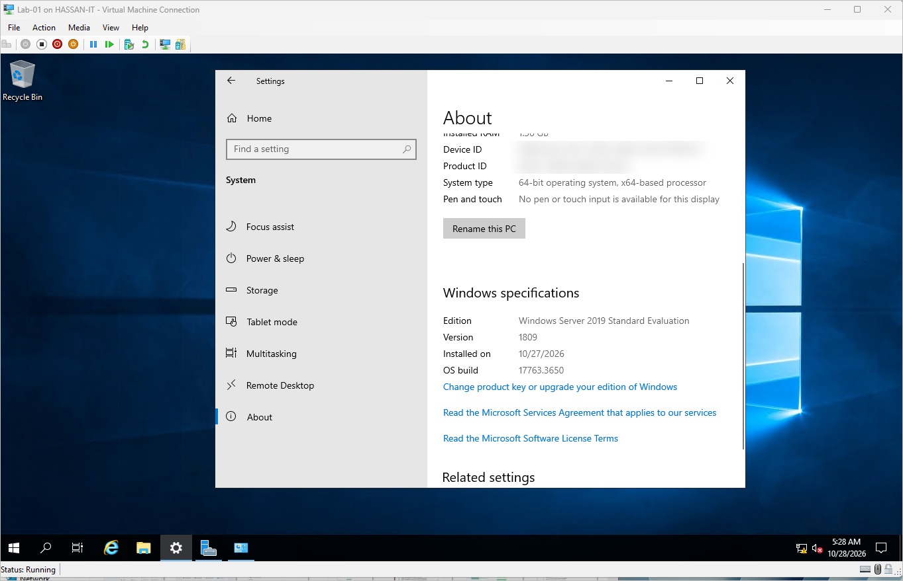

---
## Part 5: Rename the server and set a static IP

### 5.1 Rename the computer

1. Open **Settings > System > About** and click **Rename this PC**.

2. Type **LAB-DC01**, click **Next**, then **Restart now**.

### 5.2 Set a static IP address

1. Press **Win + R**, type **ncpa.cpl** and press Enter.

2. Right-click the Ethernet adapter > **Properties** > **Internet Protocol Version 4 (TCP/IPv4)** > **Properties**.

   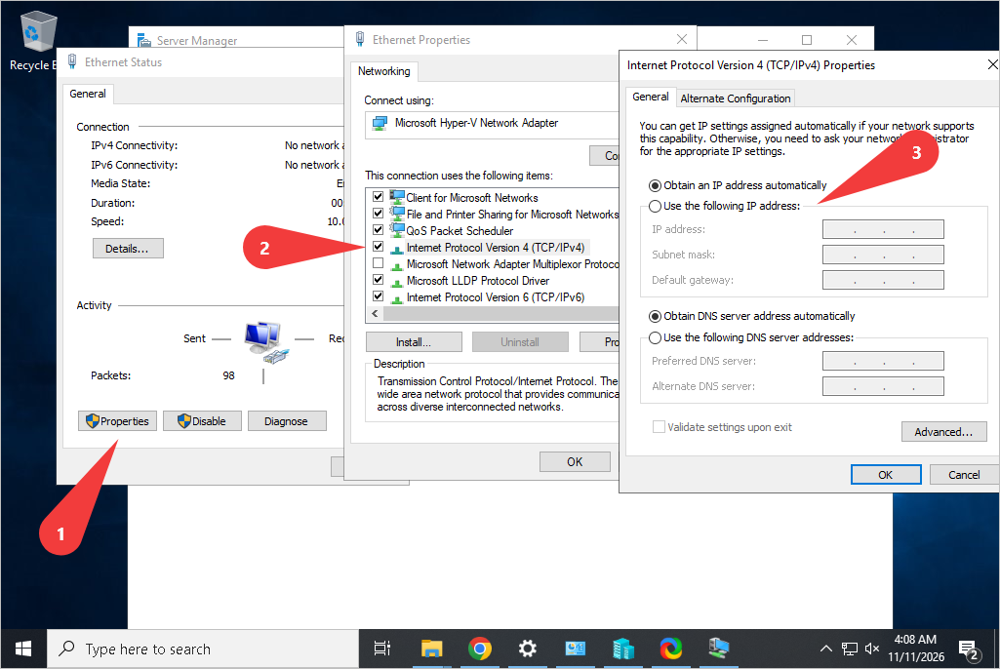

3. Enter these values and click **OK** twice:

   - IP address: **192.168.100.10**
   - Subnet mask: **255.255.255.0**
   - Default gateway: **(leave empty)**
   - Preferred DNS server: **192.168.100.10**

   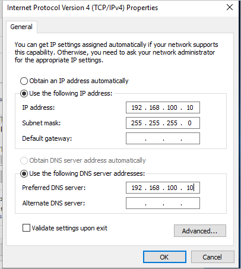

---
## Part 6: Install Active Directory Domain Services

### 6.1 Add the role

1. Open **Server Manager > Manage > Add Roles and Features**.

2. Click **Next** until **Server Roles**. Tick **Active Directory Domain Services**, click **Add Features** and then **Next**.

   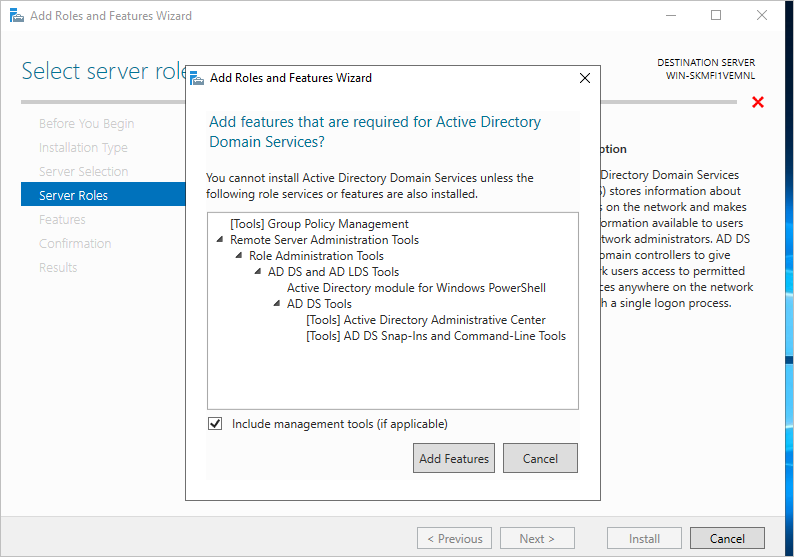

3. Click **Next** on the remaining pages and then **Install**. Wait until the installation completes.

   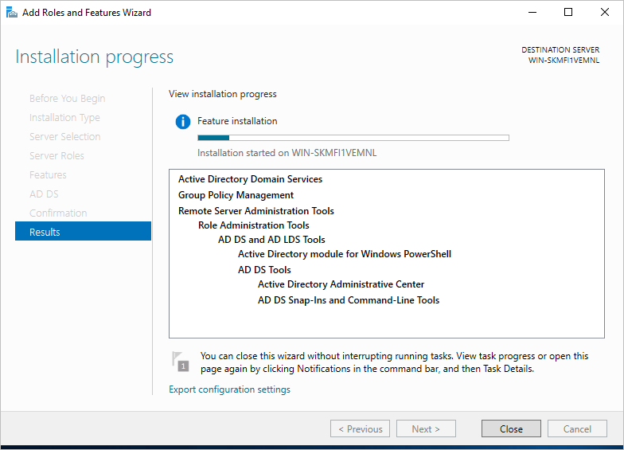

### 6.2 Promote the server to a Domain Controller

1. In Server Manager click the yellow flag at the top and select **Promote this server to a domain controller**.

   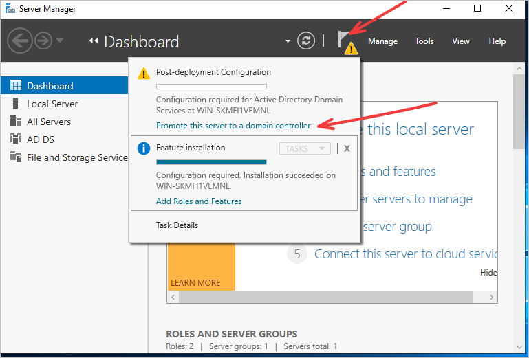

2. Select **Add a new forest** and type the root domain name **lab.local**.

   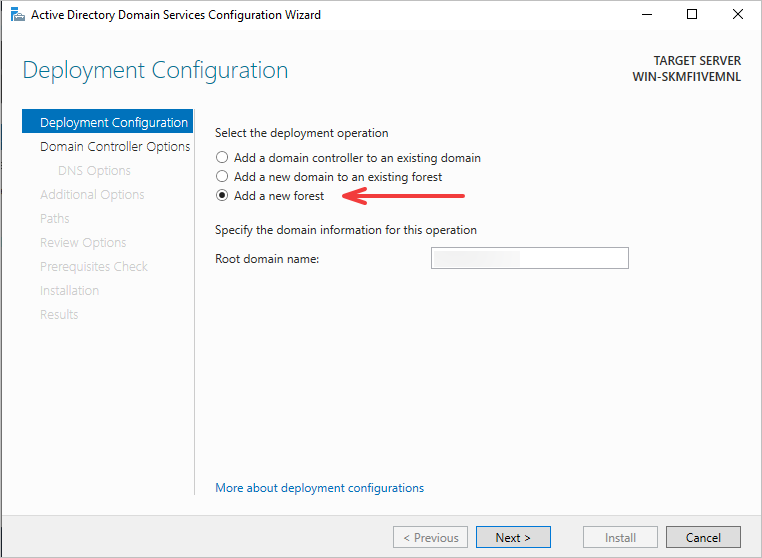

3. Leave the functional levels at default. Set the **Directory Services Restore Mode (DSRM) password** and keep it safe.

   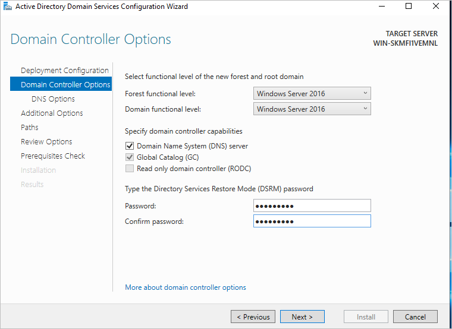

4. On the DNS Options page the warning "A delegation for this DNS server cannot be created" is normal. Click **Next**.

5. NetBIOS name: **LAB**. Keep the default paths and click **Next** until **Prerequisites Check**.

   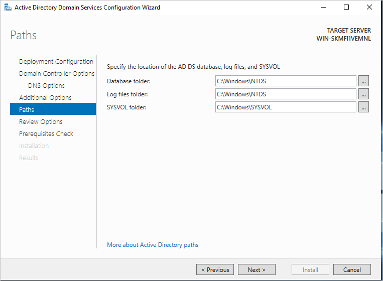

6. When the check passes, click **Install**. The server restarts by itself.

7. Sign in as **LAB\Administrator** with the same password as before.

### Optional: do the same setup with PowerShell

The whole domain setup can also be done with two commands. Open PowerShell as administrator.

This command installs the Active Directory role (same as step 6.1):

```
Install-WindowsFeature AD-Domain-Services -IncludeManagementTools
```

This command creates the forest, sets the domain name and NetBIOS name, and asks for the DSRM password (same as step 6.2):

```
Install-ADDSForest -DomainName "lab.local" -DomainNetbiosName "LAB" -InstallDns
```

> **Note:** The manual wizard is recommended for learning, because it shows the other options, for example joining an existing forest or changing the database location.

---
## Part 7: Create OUs and a test user

### 7.1 Create the Organizational Units (OUs)

1. Open **Server Manager > Tools > Active Directory Users and Computers**.

2. Right-click **lab.local > New > Organizational Unit**, name it **Head Office** and click **OK**.

3. Right-click **Head Office > New > Organizational Unit** and create **Accounts Dept**. Repeat to create **IT Dept** inside Head Office.

4. Right-click **lab.local** again and create **Disabled Account's** (outside Head Office).

The final structure should look like this:

```
lab.local
+-- Head Office
|   +-- Accounts Dept
|   +-- IT Dept
+-- Disabled Account's
```

### 7.2 Create a test user

1. Click **Accounts Dept**, then right-click > **New > User**.

2. First name **Account**, last name **User1**, user logon name **Acc1**. Click **Next**.

3. Enter a password such as **Lab@12345** (8+ characters with a capital letter, a small letter and a number). Untick **User must change password at next logon**, tick **Password never expires**, and click **Next > Finish**.

> **Note:** These password settings are only for the lab. In a real environment set them according to your organization's policy.

---
## Part 8: Verify the Domain Controller

1. Open PowerShell as administrator and run **Get-ADDomain**. It should show the domain lab.local.

2. Run **dcdiag /q**. No output means no errors were found.

3. In Server Manager > Tools you should now see **Active Directory Users and Computers**, **Group Policy Management** and **DNS**.

Your Domain Controller is ready. The next step is to create a client VM, join it to lab.local and test Group Policy.
